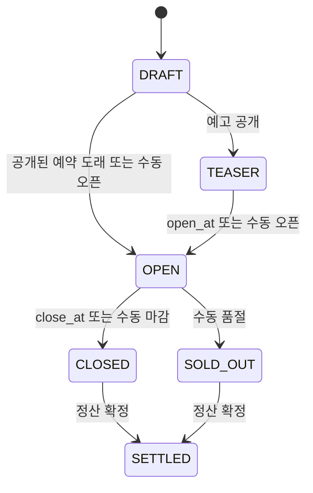
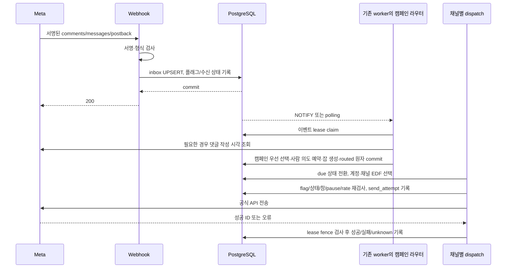

# 공구 캠페인 설계

작성일·공식 문서 확인일: **2026-10-21 UTC**  
기준 커밋: `dbec90ce1491ab034ef692e6b2d0bd5354ebafa6`  
상태: **설계 승인됨. 단계별 구현 진행 중, 운영 배포 전.**  
조사 근거: [00-current-state.md](00-current-state.md)

## 1. 목표와 승인 경계

기존 PostgreSQL worker와 Instagram Login 연결을 확장해 캠페인별 운영, 단계별 응답, 예약, 브랜드 리포트를 제공한다. 우선순위는 발송 신뢰성 → 계정 보호 → 집계 정확도다. 새 큐 서비스, 비공식 Instagram API, 콜드 DM, 주문 연동은 도입하지 않는다.

이 문서의 테이블·함수·화면은 목표 설계이며 구현 완료 여부는 각 PR에서 확인한다. 2026-10-21 사용자 결정:

- Q1 승인: 외부 발송 결과가 불명확하면 **확인 필요(unknown)** 로 남기고 자동 재전송하지 않는다.
- Q2 승인: 처음부터 팔로우 조회를 가정하지 않고 사용자 응답·동의 확보 후 확인한다.
- Q3 해소: **기존 유료 고객이 없으므로 전환·승계 설계는 제외한다.** 신규 Free/Pro entitlement를 구성하며 기존 Agency 고객 매핑을 만들지 않는다. 가격 변경은 이번 승인에 포함하지 않는다.
- 수용량 목표: **250계정 동시 운영**. 기본 400/h에서는 private reply 약 27.8 calls/s, 750/h에서는 약 52.1 calls/s. Redis 추가 없이 PostgreSQL 큐로 검증한다. 2 vCPU/8GB 공유 호스트에서의 실제 수용량은 미검증이며 다중 계정 부하 결과로 판단한다.

승인된 설계의 핵심 경계:

1. **DB만으로 Meta 전송과 로컬 기록의 exactly-once는 보장할 수 없다.** 외부 성공 직후 장애는 승인된 정책대로 `unknown`으로 보류하고 자동 재전송하지 않는다. “누락·중복 0” 시험과 결과 불명 장애 시험을 구분한다(§7, Q1).
2. **댓글만 남긴 신규 사용자의 팔로우 여부를 곧바로 조회할 수 있다는 전제가 성립하지 않는다.** 동의를 얻는 최초 private reply를 먼저 보내는 경로가 필요하다(§2, §9, Q2).
3. **Free 활성 공구 1개 제한은 최초 캠페인 공개부터 적용한다.** 이를 위해 entitlement 기반을 M1으로 앞당기고, M2에서 Pro 기능 전체에 적용한다. 기존 월 DM 과금은 별도 보존한다(§11, Q3).

사용자가 설계를 승인했으므로 코드·SQL·테스트와 작은 PR 작성을 진행한다. 운영 배포와 실제 외부 테스트 발송은 별도 단계다. 운영 절차는 구현과 함께 `docs/gonggu/runbook.md`로 확정한다.

## 2. Meta 공식 문서 확인과 권한

### 2.1 확인 방법과 근거

아래 공식 본문을 2026-10-21에 읽었다. 검색 브라우저는 일부 URL에서 429/로그인 페이지를 반환했지만 같은 공개 문서를 HTTP로 직접 조회하여 200 응답 본문을 확인했다. 검색 결과나 경쟁사 설명을 플랫폼 규칙의 근거로 사용하지 않았다. 조회일은 문서의 최종 개정일을 의미하지 않는다. 구현 PR에서 변경 여부를 다시 확인한다.

| ID | 공식 문서 | 확인한 내용·설계 영향 |
| --- | --- | --- |
| M1 | [Private Replies](https://developers.facebook.com/docs/instagram-platform/instagram-api-with-instagram-login/messaging-api/private-replies/) | 댓글 기반 첫 private reply는 1회, 게시물·릴스 댓글 생성 후 7일 안. 후속 메시지는 수신자 응답 후 24시간 안. Live는 별도 제약이므로 범위 제외 |
| M2 | [Instagram Platform Overview](https://developers.facebook.com/documentation/instagram-platform/overview.md) | 게시물·릴스 private reply는 IG professional account당 750 calls/hour. text/link Send API는 별도 제한. 400/h는 링포 정책이며 Meta 보장 속도가 아님 |
| M3 | [User Profile API](https://developers.facebook.com/documentation/instagram-platform/instagram-api-with-instagram-login/messaging-api/user-profile.md) | `is_user_follow_business` 존재. 프로필 조회에 동의 필요. 사용자 메시지, icebreaker, persistent menu 행동을 동의 조건으로 명시; 댓글만으로 동의 확보 불가 |
| M4 | [IG Comment](https://developers.facebook.com/documentation/instagram-platform/instagram-graph-api/reference/ig-comment.md) | `GET /{comment-id}?fields=timestamp,from,media` 가능. `timestamp`는 댓글 생성 시각. Instagram Login의 basic/manage_comments로 접근 |
| M5 | [Webhook Setup](https://developers.facebook.com/documentation/instagram-platform/webhooks/setup.md), [Examples](https://developers.facebook.com/documentation/instagram-platform/webhooks/examples.md) | `entry.time`은 알림 발송 시각이며 변경 발생 시각이 아님. 중복 전달 대응 필요. 댓글 생성 시각을 entry.time으로 대체하지 않음 |
| M6 | [Error Codes](https://developers.facebook.com/docs/messenger-platform/error-codes/), [Graph rate limits](https://developers.facebook.com/docs/graph-api/overview/rate-limiting/) | `100/2534025`는 private reply에 유효하지 않은 댓글이라는 넓은 의미. `10/2534022`는 허용 창 밖. 4/17/32/613 등의 제한은 endpoint·subcode까지 해석 |
| M7 | [Messaging](https://developers.facebook.com/documentation/instagram-platform/instagram-api-with-instagram-login/messaging-api.md), [Quick Replies](https://developers.facebook.com/documentation/instagram-platform/instagram-api-with-instagram-login/messaging-api/quick-replies.md), [Button Template](https://developers.facebook.com/documentation/instagram-platform/instagram-api-with-instagram-login/messaging-api/button-template.md) | 일반 DM은 사용자 행동이 선행. quick reply는 사용자 메시지 webhook을 발생시킴. URL 버튼 클릭을 대화 창 개방으로 취급하지 않음. private reply 내 postback의 프로필 동의 여부는 별도 실증 필요 |
| M8 | [Webhook Fields](https://developers.facebook.com/documentation/instagram-platform/webhooks/fields.md) | comments/messages/messaging_postbacks와 message_echoes의 권한 구분. Instagram Login에서 message_echoes 필드가 있어 셀러 직접 응답 감지 가능성을 검증할 근거가 됨 |
| M9 | [Instagram Media](https://developers.facebook.com/documentation/instagram-platform/reference/instagram-media.md) | `owner`는 미디어를 생성한 IG user의 ID이며 앱 사용자가 소유한 경우에 반환. 캠페인 연결 시 `owner.id`와 계정 ID를 검증하며, 응답 필드가 없으면 연결을 거부. 확인일 2026-10-21 |

“계정 소유자 댓글은 webhook을 트리거하지 않는다”는 지시서의 단정은 이번에 확인한 최신 setup 본문에서 재확인하지 못했다. 기존 자기 댓글 필터를 유지하고 실제 점검은 반드시 다른 댓글 계정으로 한다. 이 항목은 실계정 검증 전 확인 완료로 표시하지 않는다.

### 2.2 새 Meta 권한 필요 여부

**설계한 범위에 새 OAuth 권한은 없음.** 현재 요청하는 아래 세 권한으로 구성한다. 이는 모든 계정의 실제 grant·앱 설정이 확인됐다는 뜻은 아니다. 일반 고객 계정에서 Advanced Access와 token grant를 확인해야 한다.

| 기능 | 사용 권한 | 근거/남은 검증 |
| --- | --- | --- |
| 소유 게시물·릴스 선택 | `instagram_business_basic` | 기존 listMedia/getMedia, M2 |
| 댓글 작성 시각·공개 답글·private reply | basic + `instagram_business_manage_comments` | M1/M4. private reply에 일반 DM 권한을 추가로 발명하지 않음 |
| 팔로우 프로필 조회·postback 후 DM·FAQ | basic + `instagram_business_manage_messages` | M3/M7/M8. 동의·24시간 창은 권한과 별도로 검증 |
| 셀러 직접 응답 감지 | M8의 `message_echoes`는 basic + manage_comments로 표시됨 | 기존 scope에 포함되지만 **새 webhook 필드 구독/실제 echo 형식 검증** 필요. 새로운 OAuth 권한과 구독 변경은 구별 |
| 클릭·리포트·공유·PDF | Meta 권한 불필요 | 링포 저장 자료를 집계. insights·광고·연락처 권한 불필요 |

FAQ 직접 응답 감지가 앱 설정/계정에 따라 작동하지 않으면 자동 FAQ를 일반 공개하지 않는다. 신규 권한이 실제 필요하다고 밝혀질 경우 이름·endpoint·공식 근거를 먼저 보고하고 승인 전 구현하지 않는다. Human Agent 태그로 자동 응답 창을 늘리지 않는다.

### 2.3 오류 분류

기존 `classifyError`/GraphClient를 확장하고 채널, HTTP status, code, subcode, request ID, timeout 단계를 함께 기록한다. 오류 메시지 원문에는 개인정보·토큰이 섞일 수 있으므로 정제한다.

| 오류 | 제안 처리 |
| --- | --- |
| 4, 17, 32, 613/2534040, 80002, HTTP 429 | 제한 원장 기록, Retry-After/usage header가 있으면 반영, 지수 backoff와 계정 breaker. 32는 Pages 계열 코드이므로 이 API에서 실제 발생 여부를 fixture로 구분 |
| 100/2534029, 정책/스팸 경고 subcode | 자동 보내기 중단, 원인 해소/계정 상태 확인. 영구 제재를 6시간 뒤 무조건 재개하지 않음 |
| 100/2534025 | `failed:invalid_private_reply`; 기존 전송과 관련된 불명 상황이면 `unknown`. **발송 성공으로 간주하지 않음**, 자동 재시도 없음 |
| 10/2534022, 10/2018278 | `expired:window_closed`. private reply 7일/일반 DM 24시간 문맥을 구분, 즉시 최종 처리 |
| 190, 200/2534041 | 재인증/메시지 접근 설정 안내, 해당 채널 중단. 반복 자동 재시도 없음 |
| 100/2534015 | 확실한 거부 응답일 때만 검증된 text fallback 1회. 모든 code 100에 fallback하지 않음 |
| 1/2/5xx/네트워크 오류 | 조회는 bounded retry. **쓰기 요청이 수락됐을 가능성이 있으면 unknown**. 미전송/명확한 일시 거부가 증명된 경우만 재시도 |
| 기타 | 기본 최종 실패/검토; 미분류 쓰기 오류를 무조건 transient로 재발송하지 않음 |

제품 기본값(400/h, 지터 3~5초, 1시간 여유, 자동 일시정지 6시간)은 Meta 수치와 구분하여 설정 테이블에 둔다.

## 3. 기존 관례와의 결합

- Drizzle/PostgreSQL, 기존 worker process·loop·scheduler·LISTEN/NOTIFY를 유지한다. 캠페인 메시지는 기존 comment_events와 연결된 영속 `dm_jobs`로 분리한다. webhook 이벤트 1개에 공개 답글과 DM 각각의 결과·deadline이 필요하기 때문이다.
- `src/server/campaigns/{service,state,matcher,routing,report}.ts`, `src/server/pipeline/`·`queue/` 확장, `src/lib/campaign-schema.ts`, `src/app/app/campaigns/`를 제안한다. 실제 파일 분할은 PR 크기에 맞춘다.
- 기존 UI의 media picker, message preview, 상태 badge, 인증·소유권 검사, GraphClient, crypto, bot 필터, 이메일 전송을 재사용한다.
- 기존 `/l/{code}`와 `links(event_id UNIQUE)`는 그대로 유지한다. M1-4에서 확인한 다상품/옵션 요구 때문에 공구는 `campaign_tracked_links`와 `/r/{code}`를 추가한다. 기존 난수 코드·bot 판별·UTF-8 렌더 helper를 재사용하며, 단일 이벤트/단일 링크 전제를 바꿔 legacy 회귀를 만들지 않는다. 이미 발송한 모든 링크는 계속 열린다.
- 기존 매처는 NFKC를 그대로 보존한다. 같은 순수 매칭 모듈에 명시적 캠페인 NFC 정책을 추가하고 legacy 기본값을 바꾸지 않는다.
- 캠페인 상태는 코드/DB에서 기존 관례대로 `draft/teaser/open/closed/sold_out/settled`, UI·설명에서는 대문자를 사용한다.
- 모든 timestamp는 UTC `timestamptz`; 화면 입력·표시는 `Asia/Seoul`. 서버 locale에 기대지 않고 입력 시점을 UTC로 변환한다.

## 4. 데이터 모델과 DB 불변식

아래는 논리 모델이다. 구체적인 컬럼·CHECK·인덱스는 승인 후 Drizzle migration으로 작성한다. 모든 서비스·Server Action은 session user → 계정 → 캠페인 소유권을 검사하고, 교차 계정 FK는 composite key/CHECK 가능한 부분과 트랜잭션 검증으로 차단한다.

| 기존/신규 | 주요 필드·역할 | 제약·인덱스 |
| --- | --- | --- |
| 신규 `campaigns` | user/account, title, brand, slug, status, version, published_at, open_at, close_at, 실제 opened_at/closed_at/settled_at, follow_only, follow_failure_policy, hourly_rate, expiry_fallback_enabled, template revision | `open_at < close_at`, rate 범위, `(account,status)`, due-time 인덱스. DRAFT 저장과 publish 구분 |
| 신규 `campaign_products` | campaign, 상품명, 옵션명, original_url, stable content key, sort order, archived_at | HTTPS만; 자체 단축 URL·javascript 등 금지. 보내진 상품은 물리 삭제 대신 archive |
| 신규 `campaign_media` | campaign/account/media, permalink, routing_enabled, linked_at/released_at | 한 계정·media의 `routing_enabled=true` partial UNIQUE. 미디어 소유권 API 검증. media_cache는 필수가 아닌 캐시 |
| 신규 `campaign_rules` | campaign, 알림/링크/제외 키워드, match_type, state별 public/private template 배열, revision | 빈 정규화 키워드 금지. 템플릿 버전 감사 기록. 구조는 JSONB+Zod 검증 가능 |
| 확장 `comment_events` | campaign_id nullable, comment_created_at nullable, timestamp_source, state_at_receipt, campaign_version_at_receipt, route_owner, matched_rule/reason | 기존 comment_id UNIQUE 유지. 기존 automation_id nullable 구조 활용. 신규 `campaign_pending/campaign_processing/campaign_routed` 상태로 구 worker claim 차단 |
| 신규 `campaign_participants` | campaign/account/IGSID(업무용), recipient_hash, 최초 신청 시각, 최초 댓글 | UNIQUE(campaign, account, IGSID). 여러 미디어 댓글을 한 사람으로 묶음 |
| 신규 `campaign_deliveries` | participant, logical_intent, owning_job, state | UNIQUE(campaign, participant, logical_intent). 물리 잡 종류와 논리 의도를 분리. failed/unknown에서도 자동으로 예약 해제하지 않음 |
| 신규 `dm_jobs` | campaign, source comment/message, participant, channel, kind, scheduled_at, deadline_at, hard_expires_at, state, attempts, lease_owner/until/version, next_attempt_at, idempotency_key, template_revision_used, provider_message_id, error | idempotency_key UNIQUE. 조건별 source FK/CHECK. queue 인덱스(account, channel, state, deadline_at, comment_created_at, id). source event와 생성 트랜잭션 공유 |
| 신규 `send_attempts` | job/lease version, attempt number, request fingerprint, started/finished_at, accepted/definite_failure/unknown, provider ID/error | UNIQUE(job, attempt). API 호출 직전 durable 기록. raw token·원문 로그 제외 |
| 신규 `private_reply_claims` | comment_id, job 또는 legacy event, consumed/unknown | comment_id UNIQUE. 팔로우 요청·대체·링크가 같은 댓글의 1회 권리를 공유 |
| 기존 `follow_gates`, 신규 `message_events`, 공구 `dm_jobs` | M1-4c 구현에서 legacy gate는 보존하고 캠페인의 최초 `follow_request` job ID를 gate로 재사용한다. 수신 이벤트/Meta 시각/peer/삭제 tombstone/lease, 일반 DM의 source_message_event_id | 캠페인 참가자·link/reminder delivery UNIQUE를 재사용해 별도 gate 상태의 불일치를 피한다. `cg1:{job_id}`와 기존 `fg:` namespace 분리, account+expected peer 검증 |
| 신규 `message_events`, `conversation_states` | account/sender, provider event ID, Meta occurred_at, kind/message/postback/echo, 제한된 본문, processing state; last_user_interaction_at, consent_evidence, automation_paused_until, current_campaign | message event UNIQUE(account, provider event ID); ID 없는 postback은 안정된 원본 필드 fingerprint. 대화 UNIQUE(account, IGSID). 창은 수신 시각으로 연장하지 않음 |
| 신규 `campaign_faqs` | campaign, keyword/exclusion/match_type, answer, priority, active | 결정적 키워드 매칭. FAQ 1개 선택, 불명확하면 무응답/셀러 확인 |
| 신규 `account_send_controls`, `rate_buckets` | manual pause, channel pause_until/reason, error streak; account/channel tokens/refilled_at/next_eligible_at/rate | UNIQUE(account, channel), DB lock으로 원자 갱신. Meta 공통 한도와 캠페인 cap 모두 확인 |
| 신규 `audit_events`, `notification_outbox` | actor/action/reason/before/after/version/time; 상태·보호 알림 idempotency key, attempts/run_at | UNIQUE 전환 요청 ID/캠페인 전환 version. 알림은 commit 후 기존 email sender로 발송 |
| 확장 `links`, 신규 `click_events` | links에 campaign/product/option/logical_delivery, recipient_hash, immutable target URL/UTM; click에 시간/hash/product/link | 기존 code UNIQUE 유지. 공구 링크 UNIQUE(delivery, product). 클릭 인덱스(campaign, occurred_at), (campaign, recipient_hash). IP 저장 안 함 |
| 신규 `manual_order_entries` | campaign/product nullable, 주문 수, KRW 정수 금액, 입력 근거/수정자 | 음수 금지, 수정 감사. 고객 이름/전화번호/주문별 개인 정보는 수집하지 않음 |
| 신규 `report_snapshots`, `report_shares` | 집계 JSON/스키마 버전/as_of/finalized; campaign/snapshot ID, token_hash, revoked_at/expiry | 집계만 저장, token_hash UNIQUE, 공유는 특정 snapshot을 참조. 개인별 rows 포함 금지 |
| 신규 `report_referrals` | 공유 report의 가입 유입용 별도 비밀 아닌 code, first-touch/click time, 가입 user 연결 | 가입 1회 귀속 UNIQUE(user); 브랜드에는 합계만. 공유 접근 토큰을 가입 URL로 전파하지 않음 |
| 신규 `feature_flags`, `feature_flag_overrides`, `plan_entitlements` | flag 전역/계정 허용; plan, key, typed boolean/integer value, version | `gonggu_campaigns` 기본 false. UNIQUE(plan,key). NULL 한도는 무제한, missing은 권한 없음 |

보안상의 IGSID 필요 데이터와 분석용 HMAC은 구분한다. 업무용 IGSID를 단순 SHA로 분석에 복사하지 않는다. `HMAC-SHA256(analytics_key_version, account_id:campaign_id:IGSID)`를 사용하고 키 버전을 저장한다. 분석 테이블에 username, comment text, raw IGSID, raw IP는 없다.

### 4.1 한 댓글·한 사람·한 응답의 의미

- **한 댓글에는 하나의 규칙 묶음만 실행**한다. 그 묶음은 공개 대댓글 1개와 private reply 잡 1개를 포함할 수 있다. “한 동작”을 둘 중 하나만 보내라는 뜻으로 해석하지 않는다.
- public acknowledgment는 캠페인/사람의 `public_ack` 1개를 권고한다. 같은 댓글 및 같은 사람의 반복 댓글에서 중복 응답하지 않는다.
- `opening_link`와 `instant_link`는 같은 `link` 의도다. `follow_request`, `expiry_fallback`, `closed_notice`는 각각 별도 kind지만 모두 최초 private reply `initial_contact` 슬롯을 경쟁한다.
- 최초 댓글 처리 시 participant의 `initial_contact`와 필요한 `link` 의도를 원자적으로 예약한다. 예약/발송/unknown이면 새 댓글이 새 private reply를 만들지 않는다. CLOSED 안내도 이전 private reply가 있으면 생성하지 않는다.
- **예외:** 팔로우 요청 뒤 사용자가 실제 응답하여 24시간 창이 열리면 일반 DM으로 link 의도를 완료할 수 있다. FAQ는 신규 사용자 메시지 ID당 1개이며 최초 private reply 중복 규칙과 별도다. “전체 DM 평생 1개”라는 해석과는 다르므로 Q4에서 승인받는다.
- 대체 DM이 먼저 발송되면 오픈 시 같은 댓글에 두 번째 private reply를 보내지 않는다. 새 일반 DM 창이 없으면 오픈 링크 자동 후속 발송도 없다.
- dedupe conflict는 `skipped_duplicate`로 이유·원본 작업을 남긴다. duplicate를 발송 실패로 집계하지 않는다.
- API 시도가 0회이고 이미 expired/canceled인 잡은 실제 연락하지 않은 것이 확인되므로, **새 댓글**이 들어오면 최초 응답 의도를 새 잡으로 옮길 수 있다. 기존 댓글의 권리는 다시 쓰지 않으며 sent/unknown/failed/시도 이력이 있는 잡은 자동 해제하지 않는다. 공개 답글은 별도 사람당 의도를 유지한다.

## 5. 상태 기계·시간·수정 정책

| 상황 | 제안 규칙 |
| --- | --- |
| 초안 | published_at 없는 DRAFT는 시간이 지나도 열리지 않음. publish가 일정·미디어·entitlement를 검증 |
| 자동 전환 | 기존 scheduler에서 5초 주기 due scan. DB가 사실의 원천이며 재시작 시 밀린 전환도 처리 |
| 원자성 | campaign row lock + expected version/CAS. 상태 변경·감사·outbox를 같은 tx에서 commit. 동일 request/version의 재실행은 no-op |
| 여러 시각이 지난 재시작 | OPEN→CLOSED 감사 순서를 기록하되 마지막 현재 상태가 CLOSED면 구매 링크 dispatch하지 않음. 예정 시각과 실제 처리 시각 모두 기록 |
| 수동 조기 오픈 | effective opened_at=DB now. 기존 미발송 opening job을 새 opened_at로 당김; deadline은 댓글 시각 기준 유지 |
| 일정 지연/속도 수정 | waiting/retry 잡만 version을 올려 재계산, 위험 수·ETA 재계산. 이미 API 호출을 시작한 잡은 새 잡으로 만들지 않음 |
| 마감/품절 | 미발송 구매 링크는 폐기하지 않고 `canceled:campaign_closed`로 종료하는 안 권고. 신규 링크 댓글은 closed_notice. 이미 발송된 사람에게 추가 마감 DM 없음 |
| 마감과 전송 경합 | dispatch 직전 campaign/version/pause 재검증. 전송 허가 뒤 Meta 호출 중 마감될 수 있다는 경계는 남으며 in-flight로 표시. 마감이 이미 진행 중인 API를 취소했다고 보장하지 않음 |
| SETTLED | closed/sold_out에서만 허용. 미완료/unknown 건이 있으면 확정 전 별도 경고·승인. final snapshot 고정. 재오픈은 이번 범위 제외 |
| 삭제 | DRAFT 무참조는 삭제 가능. 공개 캠페인은 archive/cancel+감사, 진행 잡은 즉시 중단. 개인정보 삭제 요청은 별도 물리 삭제 |

`campaign_media.routing_enabled`는 TEASER/OPEN뿐 아니라 CLOSED/SOLD_OUT 마감 안내에도 필요하다. 활성 공구 과금은 TEASER/OPEN(및 공개 예약 DRAFT)을 세되, 종료 캠페인의 미디어 소유권은 명시적 해제/다른 캠페인 이관까지 유지하는 안이다. 이관은 한 tx에서 기존 routing off/new routing on으로 수행하고 기존 이벤트의 소유권은 바꾸지 않는다(Q5).

### 5.1 댓글 작성 시각과 deadline

1. Meta가 문서화한 댓글 생성 시각 필드가 실제 payload에 있으면 출처와 함께 저장한다. 없으면 비동기 `GraphClient.getComment`를 추가하여 `timestamp`를 읽는다(M4). `entry.time`, 서버 수신 시각, 게시물 작성 시각은 사용하지 않는다.
2. 작성 시각이 없거나 검증 실패면 `waiting_metadata`로 보류한다. 조회의 bounded retry 후 실패를 노출한다. deadline을 추정해 private reply를 보내지 않는다. 조회 API 부하도 계정/앱 budget에 반영한다.
3. `hard_expires_at = comment_created_at + 7일`, `deadline_at = hard_expires_at - safety_margin(기본 1시간)`. 일반 DM의 deadline은 검증된 사용자 행동 시각+24시간에서 별도 짧은 전송 여유를 뺀 값이다.
4. TEASER 알림은 public_ack만 즉시 예약하고 opening_link는 `scheduled_at=open_at`. template는 보관된 문자열 사본 대신 **발송을 시작할 때 최신 revision**으로 렌더한다. 시도 후 unknown인 메시지의 본문/링크는 변경·재발송하지 않는다.
5. `open_at >= deadline_at`이면 위험 건이다. 같은 시각도 안전상 위험으로 본다. 대체 off는 deadline에서 expired; 대체 on은 **동일 최초 응답 잡의 kind를 expiry_fallback으로 변경**하고 deadline 시점부터 hard expiry 전 여유 구간에 발송을 시도한다. 발송 슬롯·네트워크 여유가 없으면 expired로 끝낸다.
6. 대체 시점에 1시간 여유가 있어도 400건 이상이 몰리면 모두 보낼 수 없다. 대체 due 작업도 슬롯을 예약·예측하고 별도 위험 수를 표시한다. 사용자의 “deadline 시점 대체 발송”은 그 시점 dispatch 가능을 의미하며 정각 전원 완료를 약속하지 않는다(Q6).

대체 문구 제안: “신청하신 {상품명} 공구는 {오픈일시 KST}에 열려요. 자세한 일정은 {공구 게시물 링크}에서 확인해 주세요.” 이 DM을 보낸 뒤 추가 오픈 DM이 자동으로 오지 않는다는 설명을 셀러 설정 화면에 둔다.

## 6. 수신 → 선택 → 잡 → 발송 시퀀스

수신은 단기 tx로 끝낸다. 캠페인만 있고 기존 automation이 없는 계정도 수집 대상이다. DB 저장 실패는 5xx로 반환하여 재전달을 받으며, 서명 실패는 거부한다. 미지원·잘못된 payload의 무한 재전달을 피하되 파싱 실패 건수는 알린다. heavy Meta 호출, PDF, 이메일은 webhook 응답 경로에서 실행하지 않는다.

### 6.1 라우팅 우선순위와 플래그

1. `gonggu_campaigns=false`인 계정의 새 댓글은 기존 ingest/매칭/pipeline 경로를 그대로 사용한다. 기존 keyword·DM quota·follow gate 동작도 보존한다.
2. enabled 계정 이벤트는 `campaign_pending`에 먼저 저장한다. 해당 미디어의 캠페인과 **수신 시점의 effective 상태**를 기록한다. due transition이 늦었다면 일정·감사 시각으로 계산한 상태와 DB 저장 상태를 함께 기록하여 재현한다.
3. **매칭된 캠페인 규칙 > 기존 specific(이미 묶인 next 포함) > 기존 all.** 캠페인 rule이 없거나 무관한 키워드면 legacy matcher를 실행한다. 캠페인 rule이 선택된 뒤 pause/중복/창 만료/권한 제한이면 소비된 이벤트로 끝내며 legacy에 넘기지 않는다. 그렇지 않으면 예고 보류가 즉시 legacy DM으로 새어 나갈 수 있다.
4. 캠페인의 제외어가 해당 rule을 배제할 때 기본은 legacy에도 보내지 않는 `campaign_excluded` 억제다. 단순 미매칭과 구분하고 UI에서 설명한다(Q7). keyword 세트 충돌은 상태별 규칙으로 해소: TEASER에서는 알림, OPEN에서는 link 의도 하나, CLOSED/SOLD_OUT에서는 링크 키워드만.
5. 선택 결과 route_owner와 캠페인/automation ID는 한 번 고정한다. 이미 선택된 legacy 이벤트를 새 캠페인으로 소급 이동하지 않는다. 캠페인 처리 실패 때문에 다른 규칙을 새로 선택하지 않는다.
6. legacy로 넘기는 경우 같은 event를 `pending`으로 바꾸고 기존 worker가 처리한다. 캠페인 소유 이벤트는 `campaign_routed` 등 구 worker가 claim하지 않는 상태를 사용한다. `dm_jobs`가 전송 상태의 기준이다.
7. flag off는 캠페인 생성·선택·상태 자동화·dispatch를 멈춘다. 이미 캠페인에 귀속된 이벤트/잡은 held로 보존하고 legacy로 재해석하지 않는다. 재활성화 시 deadline·상태를 다시 평가한다. 이미 발송한 링크, 공유 폐기, 데이터 삭제는 별도의 보존/보안 동작으로 유지한다.
8. flag 조회 실패는 캠페인 처리를 보류한다. enabled 여부가 불명인데 legacy로 보내지 않는다. 수신 시 flag revision, dispatch 시 최신 kill switch를 검사한다. API 호출이 시작된 in-flight까지 취소할 수는 없다.

플래그 off 회귀 검사는 “처음부터 off인 기존 사용자”의 동일 payload/DB 부작용/API 호출 비교와 “on→off”의 캠페인 잡 정지·미재전송을 따로 증명한다.

## 7. 큐, 중복, 외부 전송의 장애 경계

`dm_jobs.kind`: public_reply/opening_link/instant_link/follow_request/follow_reminder/follow_link/closed_notice/faq/expiry_fallback. 채널은 public_reply/private_reply/message로 분리한다. 조회·리포트·알림 업무는 같은 worker의 별도 DB 작업으로 처리한다.

상태는 waiting/waiting_metadata/leased/sending/retry/sent/failed/expired/skipped_duplicate/canceled/held/unknown이다. “발송 중”으로 묶어 보여 주더라도 내부 leased와 sending을 구별한다.

### 7.1 claim과 장애 복구

- 이벤트 → participant → delivery claim → private reply claim → job 생성 → 이벤트 routed를 **같은 DB tx**에 묶는다. 중복 webhook 3회, concurrent router에서도 잡 묶음은 한 번만 생긴다.
- DB에서 due job을 `FOR UPDATE SKIP LOCKED`로 claim하고 lease owner/version을 부여한다. 결과 갱신·재예약은 동일 owner/version 조건을 통과해야 한다. stale worker의 늦은 결과가 새 worker 상태를 덮지 못한다.
- lease 만료 후 `send_attempts`가 없는 leased 작업은 안전하게 재claim한다. `sending`/시작한 attempt가 있는데 확정 결과가 없으면 unknown으로 전환한다. **5분 경과했다는 이유만으로 외부 쓰기를 재실행하지 않는다.**
- 성공은 Meta message/reply ID를 DB에 기록한 경우만 sent로 인정한다. 명확한 거부만 failed/retry. 재시도는 같은 job/동일 댓글 권리를 사용한다.
- 네트워크를 기다리는 동안 장시간 DB transaction을 잡지 않는다. durable attempt를 commit한 뒤 전송하고 별도 tx로 결과를 기록한다. 이 경계 때문에 unknown이 필수다.
- graceful shutdown은 신규 claim 중단·진행 작업 drain을 재사용한다. kill -9·DB 장애도 위 원장으로 복구한다. NOTIFY가 유실되어도 polling으로 처리한다.

### 7.2 exactly-once를 주장할 수 없는 경우

| 장애 위치 | 처리·보장 |
| --- | --- |
| job 생성 전/tx rollback | webhook 재전달 또는 router 재실행. 잡 누락 방지 |
| job commit 후/claim 전 | DB에 남아 재시작 후 처리 |
| lease 후/attempt 시작 전 | lease 만료 후 안전 재실행 |
| attempt commit 후/API 호출 전 crash | 실제 미발송일 수 있으나 다른 쪽에서 입증 불가 → unknown |
| Meta 수락 후/응답 유실 또는 DB 기록 전 crash | 실제 발송일 수 있음 → unknown, 자동 재전송 금지 |
| 성공 commit 후/중복 webhook | UNIQUE/의도 예약으로 추가 전송 없음 |

Meta가 client idempotency key를 받아 결과를 재조회한다는 보장은 확인되지 않았다. 로컬 idempotency key를 Meta가 이해한다고 가정하지 않는다. private reply 1회 제약도 해당 호출이 성공했는지·어떤 내용인지 증명하지 않으며 공개 대댓글/일반 DM에는 같은 방어가 없다.

따라서 보장 목표는 **DB 잡 유실 0, 중복 의도 생성 0, 확인된 성공 재전송 0, 결과 불명 은폐 0**이다. 외부 exactly-once와 무조건 전원 도달을 동시에 보장하는 표현은 승인 없이 사용하지 않는다. unknown은 확인 가능한 메시지/echo/Meta 기록과 운영자 검토로만 해소한다. 확인 불가인 작업을 일괄 재처리하지 않는다(Q1).

### 7.3 retry

기존 backoff 함수를 재사용하여 30초 기반 지수 증가·지터, 최대 시도 기본 5회로 제안한다. rate rejection도 실제 API 시도면 횟수를 센다. 슬롯 대기·계정 pause는 시도 횟수를 쓰지 않는다. Retry-After와 다음 허용 slot 중 늦은 시각으로 재예약하고 deadline을 넘으면 expired다. 영구 실패/unknown/이미 소비된 private reply는 실패 잡 재처리 대상에서 제외한다.

## 8. 계정별 발송 제한·일시정지·ETA

### 8.1 큐 선택과 rate budget

- private reply/public reply/일반 DM은 별도 DB token bucket을 사용한다. 계정·채널 row lock 또는 advisory lock으로 refill/소모/다음 시각을 원자 갱신한다. burst capacity 기본 1, idle 후 대량 토큰 적립 금지.
- private reply 정책 기본 400/h, 셀러 설정 상한 750/h. 여러 캠페인이 같은 계정 한도를 각각 복제하지 않는다. 계정 cap 안에서 캠페인별 cap도 적용한다. 최초 캠페인 rate로 계정 rate를 설정하고 이후 계정 전체 속도와 각 캠페인의 분배 속도를 구분한다(Q8).
- token bucket만으로 rolling-hour 제한을 증명하지 않는다. **실제 API 시도 원장 기준 `(now−1h, now]` 호출 수 guard**를 추가한다. retry·fallback·unknown·legacy 호출도 포함하고 성공 건수만 세지 않는다. 지난 예약 slot을 재시작 직후 몰아서 실행하지 않는다.
- enabled 계정의 기존 public/private/follow-up DM도 같은 budget adapter를 거친다. 전체 계정 소비를 알 수 없는 구 worker와 공구 worker를 동시에 가동하지 않는다. 한번도 enabled가 아니었던 flag-OFF 계정의 limiter는 그대로 둔다. on→off 뒤에는 **마지막 공통 write+한 시간+permit 여유**까지 공통 제한을 유지한다. 이때 새 write가 생기면 여유 구간도 연장한다. OFF 순간부터 한 시간만 고정하면 그 시간 끝의 발송량과 구 경로의 새 allowance가 겹쳐 한도를 넘을 수 있어 M1-4b에서 수정했다. 이 구간 속도는 기존 기본값과 다를 수 있다. 발송이 한 시간 이상 없어 구 경로로 돌아간 후 재활성화하면 그 사이의 legacy 사용량을 확인해 필요한 warmup을 다시 적용한다.
- private reply 외 공개 답글 기본 120/h, 일반 DM 기본 400/h를 **링포 초기 정책안**으로 둔다. 공식 최대치라고 표시하지 않는다. API/앱 usage header 제한이 더 엄격하면 먼저 적용한다. 공개 3,000개는 이 기본값으로 약 25시간이므로 공개 답글과 DM ETA를 별도로 보여 준다.
- 공개 답글·DM 각각 3~5초 지터를 발송 가능 시각에 적용한다. 기본 간격은 `max(3600초 / 적용속도, jitter)`이며 네트워크 시간·대기·제한이 더해질 수 있다. 400/h에서 9초가 지배하고 750/h에서는 5초 지터 때문에 실효 속도가 약간 낮아질 수 있다. 공개 문구는 participant의 예약 순번으로 배열 순환하여 retry 때 같은 문구를 쓴다.
- 계정·채널별 dispatch를 직렬화하고, 그 안에서 ready인 잡을 `(deadline_at ASC, comment_created_at ASC, job_id ASC)`로 선택한다. 캠페인별로 먼저 batch를 선점해 deadline 순서를 깨지 않는다. 다른 계정은 설정된 worker concurrency 안에서 병렬 실행한다.
- **250계정 수용량:** private reply 기본 합계 27.8/s, 공개 답글 기본 합계 8.3/s로 약 36.1/s이며 일반 DM·메타데이터 조회·재시도는 추가다. 기존 worker concurrency 8과 inline sleep을 그대로 사용하면 이 처리량을 보장하지 못한다. 지터/속도 대기는 DB `next_attempt_at`으로 표현하고 worker slot/DB connection을 잡은 채 기다리지 않는다. 네트워크 in-flight concurrency는 측정한 API 지연에 맞춰 32~64 범위에서 검증하며, 필요한 값은 `전체 요청률 × 요청 지연(초)`에 여유를 더해 결정한다. PostgreSQL pool과 HTTP 동시성은 분리하고 외부 요청 동안 DB transaction을 열어두지 않는다. 최종 판단은 250계정의 실제 시계 모의 API 부하 시험으로 한다.
- 분산 worker는 **계정 dispatch lease를 먼저** 획득하고 해당 계정의 첫 due 잡을 claim한다. 한 잡이 장기 backoff 중이면 ready 집합에서 제외한다. API 호출 직전 lease/flag/rate/창을 다시 검사하고 지나간 전송 허가는 새로 받는다.
- due transition·expiry 검사가 전송 선택에 선행한다. 예고 잡은 OPEN 전에는 보내지 않는다. 메타데이터 조회·알림·리포트가 전송 worker pool 전체를 점유하지 않게 소량 concurrency를 분리한다.

### M1-3 구현 결정 (2026-10-21)

- 발송 원장은 `send_attempts`, 채널별 budget/lease는 `send_buckets`, 계정 설정은 `account_send_controls`, 캠페인 cap은 `campaign_rate_buckets`로 분리했다. 기존 PostgreSQL·Drizzle·worker scheduler를 확장하며 Redis는 추가하지 않는다.
- DB 허가 뒤 event loop/commit 지연으로 실제 호출이 늦어질 수 있어 2초 permit과 monotonic 검사를 추가한다. 호출 전 만료는 `not_invoked`로 기록하고 재시도 횟수/rolling call count에서 제외한다. 과거 호출 집계에는 permit 여유도 포함해 한 시간 경계의 지연 호출을 보수적으로 제한한다.
- DB transaction 안에서 campaign → job → account control → channel 순으로 잠근다. claim은 channel을 먼저 잠그되 job에는 `SKIP LOCKED`를 사용해 역방향 대기를 피한다. Meta HTTP 호출은 commit 뒤 수행한다. sender 결과는 job lease version/owner로 검증한다.
- 영구 정책 차단은 수동 확인이 필요하다. rate 자동 pause는 한 번의 half-open 호출이 성공하면 풀리고 다시 제한되면 연장한다. 수동 재개는 최근 사용량과 cooldown을 지우지 않는다.
- 발송 엔진/보호 설정/현황 화면을 먼저 검증하는 작은 PR로 분리한다. 실제 발송 루프는 추적 링크·팔로우/일반 DM 수신과 legacy 공통 budget 연결이 완료되는 M1-4에서 켠다. 기존 startEventLoop의 빈 슬롯 보충 방식을 재사용하고 campaign poll은 250ms로 검증한다. M1-3만 배포하고 운영 cohort를 활성화하지 않는다.

### 8.2 계정 보호

`account_send_controls`에 수동 all-pause와 자동 channel pause를 구분한다. 제안 기본은 5분 안에 연속 5회 rate/spam 관련 확정 오류 시 공개 대댓글 6시간 pause, 셀러 대시보드 알림+이메일 outbox다. N/관찰 구간/기간은 설정값이다. 성공이면 해당 streak를 reset하되 실제 정책 차단 오류는 별도 수동 해제가 필요하다.

예약 DM 유지 여부는 계정 설정으로 두고 기본은 **함께 일시정지**를 권고한다. public endpoint만의 일시 제한임이 확인되고 셀러가 계속 보내기를 택한 경우에만 DM을 계속한다. DM 자체의 rate 제한·인증 오류·정책 차단을 이 옵션으로 우회하지 않는다.

자동 pause 기간 종료 시 half-open으로 소량 호출하여 상태를 확인하고 재개/연장한다. 수동 pause는 자동 재개하지 않는다. 일시정지 중에도 deadline은 계속 흐르며 만료 건수와 영향을 표시한다. 일시정지/재개/정책 변경 모두 감사 로그를 남긴다.

### 8.3 완료 예상 시각과 만료 위험

기본 표시는 `max(now, effective_open_at) + 대기 링크 의도 수 ÷ 설정 시간당 속도`이다. **3,000건/400h = 7시간 30분, 3,000건/750h = 4시간**이며 이는 다른 트래픽·재시도·지터·pause·API 지연이 없는 기본 예측이다. 10분 유입 시험이 10분 내 전원 발송을 뜻하지 않는다.

실제 UI에는 계정의 다른 캠페인/legacy 소비, 이미 사용한 rolling window, EDF 순서, 지터 평균, 최근 실제 속도, pause_until을 반영한 보정 ETA와 계산 시각을 함께 표시한다. 같은 예측 순수 함수를 worker와 dashboard에서 사용한다. unknown·팔로우 응답 대기는 사용자의 행동에 달려 있어 “전원 완료 시각 확정 불가”로 구분한다.

만료 위험은 최소한 두 수로 보여 준다.

1. **일정 자체 위험:** `open_at >= deadline_at`인 미발송 신청 수.
2. **대기열 포함 위험:** 예측 발송 시각이 해당 job deadline/hard expiry를 넘는 수. 앞의 수와 중복 합산하지 않는다.

캠페인 생성 전에는 실제 댓글 수가 없으므로 입력 일정의 위험 안내와 예상 신청 수 시뮬레이션만 보여 준다. 실제 수는 생성 후 조회하며 없는 값을 0명의 실측이라고 속이지 않는다. 일정·속도 변경 미리보기에는 위험 수의 전후 차이를 보여 준다. 화면은 15~30초 polling/재검증, 집계 지연 목표 60초 이내다.

## 9. 팔로워 전용 링크와 FAQ

### 9.1 팔로워 흐름

M3에 따라 `following=true/false/unknown_consent/unknown_error`를 구분한다. 프로필 필드 누락을 false로 강제하지 않는다.

1. 기존에 검증된 프로필 조회 동의가 있는 사용자만 공식 API로 조회한다. follower=true면 최초 private reply로 링크. false면 팔로우 요청 private reply. 댓글만 남긴 신규 사용자에게는 동의가 없을 수 있어 안내+응답 요청을 먼저 보낸다.
2. 권고안은 “팔로우했어요” postback을 사용하되, **해당 private reply 형식이 지원되고 일반 DM 창을 여는지 실계정으로 확인한 다음** 활성화하는 것이다. postback이 창은 열어도 프로필 동의까지 만들지 않으면 검증된 창 안에서 quick reply/직접 텍스트 응답을 요청한다. 창 개방이 확인되지 않았으면 자동 follow-up을 보내지 않는다. 최초 안내에 직접 답장하는 대안도 설명한다.
3. 버튼의 gate ID만 신뢰하지 않는다. 계정, 서명된 webhook sender IGSID, expected sender, campaign, 만료, gate state를 검증한다. 조작/다른 사람의 payload/중복 event는 소비만 하고 보내지 않는다.
4. webhook은 message_events를 저장하고 즉시 ACK한다. worker가 사용자 행동의 **Meta timestamp**로 창을 갱신하며 순서가 뒤바뀐 이벤트가 창을 과거로 줄이거나 재전달이 창을 늘리지 않도록 `max`로 처리한다. echo/URL 방문은 사용자 행동으로 세지 않는다.
5. 다시 follower 조회 → true면 `follow_link` 일반 DM job을 link 의도에 묶어 1회 생성한다. false면 reminder 1회만 허용한다. 이후 버튼 재클릭은 조회할 수 있지만 같은 안내를 계속 발송하지 않는다. 후속 호출 직전에도 24시간 창을 검증한다.
6. **예상 가능한 동의 부재와 API 장애는 다르다.** 동의 부재에는 위 응답 유도, 동의 후 조회 timeout/5xx 등에는 셀러 `follow_failure_policy=send_link`를 기본으로 적용한다. `hold`도 선택 가능하다. fail-open으로 일반 DM 창이나 private reply 횟수 제한을 우회하지 않는다. 토큰/정책 차단은 fail-open 대상이 아니다(Q2).
7. 버튼을 누를 때 공구가 마감됐다면 새 구매 링크를 보내지 않는 안을 권고한다. 이미 최초 안내를 받은 사람에겐 추가 마감 private reply를 생성하지 않는다. 사용자 응답에 대한 일반 마감 안내 여부는 Q4에서 확정한다.

기존 follow gate 메시지 builder·GraphClient를 확장하되 기존 `fg:` payload와 동작은 호환한다. 캠페인 gate는 별도 namespace/version을 쓴다. opaque nonce만으로 권한 검사를 대신하지 않는다.

### 9.2 FAQ

- OPEN 캠페인에 대한 수신 DM만 처리한다. `conversation_states.current_campaign`은 실제 링크 전달/gate 맥락에서 설정한다. 같은 계정의 여러 공구 중 문의 대상이 모호하면 추측해서 특정 상품 답변을 하지 않고 셀러 확인으로 넘긴다.
- 캠페인 FAQ 키워드·제외어·우선순위를 순수 함수로 매칭한다. 사용자 입력을 코드나 명령으로 실행하거나 LLM 호출에 의존하지 않는다. 문의 메시지 ID당 FAQ 답변 1개, 대화별 추가 cooldown을 둔다.
- enqueue와 dispatch 양쪽에서 `now < last_verified_user_interaction_at + 24h`를 확인한다. 24시간 밖은 expired, 새 사용자 DM이 오면 새 event로 처리한다. 예전 FAQ를 창이 다시 열렸다고 전부 재생하지 않는다.
- `message_echoes`/실제 echo fixture로 셀러의 Instagram 앱 직접 답변을 감지한다. 링포 발송 message ID와 일치한 echo는 자동 발송으로 구분하고, 미상 outgoing은 보수적으로 셀러 응답으로 판단하여 pause한다.
- 셀러 응답 시 기본 1시간 conversation pause, waiting FAQ 취소, 수동 pause/resume 제공을 제안한다. 메시지 시각 순서 경합을 다루며 send 직전 재검사한다. 이미 in-flight인 답변까지 취소했다고 주장하지 않는다. echo가 도착하지 않는 계정에서 “수동 답변 시 자동 중단”을 완료로 표시하지 않는다(Q9).

## 10. 추적 링크·리포트·공유

### 10.1 클릭과 집계 정확성

기존 링크 helper를 재사용하는 공구 resolver를 추가한다. `campaign_tracked_links`는 UNIQUE(job_id, product_id, target_hash), `campaign_click_events`는 클릭별 recipient HMAC만 저장한다. 기존 `links`의 event_id 유일성은 다상품·옵션을 담지 못하므로 기존 스키마를 바꾸는 대신 추가 테이블로 분리했다. DM attempt를 만들기 전에 의도/상품별 링크를 원자적으로 get-or-create한다. 상품 URL과 UTM은 발송 시점에 고정하고, 미발송 잡만 최신 상품·템플릿을 쓴다. 이미 발송한 링크의 목표 URL은 바꾸지 않는다.

상품이 2개 이상이면 불투명한 `/c/{code}` 선택 화면에서 모든 상품·옵션을 보여준다. 상품 링크와 선택 화면 모두 22자리 base62 난수(약 131bit)를 쓴다. 선택 화면은 제목·브랜드·상품명·옵션·링크 code만 직렬화하고 로그인 없이 열린다. catalog도 내용을 수정하지 않고 revision마다 새 code를 사용한다. 공개 답글과 팔로우 요청에는 수신자별 구매 링크를 넣지 않는다. 메시지 본문은 기존 UTF-8 축약 helper로 제한하고, 필수 구매 URL/만료 일정·게시물 URL은 잘리지 않게 별도로 보존한다. text 1000byte, button body 640character 제약은 2026-10-21 공식 Send API/Button Template 문서 확인에 근거한다.

UTM은 URL API로 원본 query/fragment를 보존하면서 `utm_source=instagram`, `utm_medium=dm`, `utm_campaign=stable_slug`, `utm_content=상품명 / 옵션`을 붙인다. 상품/옵션 ID는 DB에서 별도 집계하며 발송된 URL은 이름 수정 후에도 그대로 둔다. 원본에 같은 UTM 키가 있으면 공구용 값을 우선한다는 UI 설명을 둔다. 서명된 URL처럼 query 추가로 깨지는 상품은 원본 보존 옵션/검증이 필요하다(Q10).

GET만 집계하며 HEAD·preview/prefetch는 redirect하되 집계하지 않는다. 기존 bot UA 필터를 확장·재사용한다. 알려진 Meta crawler와 실제 human fixture를 테스트한다. UA 기반 필터는 모든 bot을 판별하는 수단은 아니므로 리포트에는 “추적 링크 기준”으로 표기한다.

click_events에는 발생 UTC 시각, 링크/캠페인/상품, recipient_hash만 저장한다. raw IP·raw UA·username은 저장하지 않는다. 한 요청의 이벤트 insert와 legacy 호환 counter increment는 한 tx로 처리한다. DB 장애 시 redirect는 가능한 경우 제공하되 클릭 저장 누락 가능성을 metric/리포트 품질 표시로 남긴다. 유실을 숨기고 정확 집계라고 표시하지 않는다(Q11).

“고유 클릭”은 **해당 링크를 받은 수신자 hash 기준**이다. 링크를 다른 사람에게 전달해도 원 수신자에 귀속되므로 실제 방문자 수/구매 전환 수와 동일하지 않다. 전체 클릭은 필터를 통과한 GET 횟수다. 사용자가 재방문하면 전체는 증가하고 고유는 유지한다.

### 10.2 리포트 지표 정의

| 지표 | 분모·집계 기준 |
| --- | --- |
| 알림 신청 | TEASER 알림 규칙에 수락된 distinct participant. 중복 댓글·public 성공 여부와 분리 |
| DM 발송/실패/만료/대기/unknown | DM 채널의 logical job 결과. 최초 안내, 구매 링크, 대체, 마감, FAQ를 하위 분류. retry attempt 수를 발송 수로 더하지 않음 |
| 링크 발송 | 구매 링크를 포함하는 job이 Meta 성공 ID로 확정된 distinct recipient. 링크 row 생성 수를 사용하지 않음 |
| 고유/전체 클릭 | human 인정 click_events. 캠페인 고유는 상품별 고유 합이 아닌 캠페인 전체 distinct hash |
| 클릭률 | **구매 링크 수신자의 고유 클릭 ÷ 확인된 구매 링크 발송 수 × 100**. 전체 안내 DM까지 분모로 섞지 않음. 분모 0은 0% 대신 `—` |
| 결과 불명 링크 클릭 | unknown 발송의 링크 클릭은 별도 수로 노출. 클릭이 있었다는 이유만으로 Meta 발송 성공으로 변경하지 않음 |
| 상품·옵션·시간대 | stable product/option key, UTC 집계 후 KST 시간 버킷 표시 |
| 주문·매출 | 셀러 입력값이라는 표기, KRW 정수, 수정 이력. 추적 클릭으로 주문을 추정하지 않음 |
| 직전 공구 대비 | 같은 seller의 직전 종료 공구를 명시적으로 선택, 동일 지표 정의/관측 기간 비교. 이전 0/없음은 증감률 `—`, 절대 차이는 별도 |

DB 집계는 30초 주기 또는 요청 시 계산하고 60초 이내 갱신을 목표로 한다. materialized 결과에는 `as_of`와 집계 버전이 있다. PII 보존 종료 전에 집계 snapshot을 만들어 raw 삭제가 기존 리포트 수치를 조용히 바꾸지 않도록 한다. 데이터 삭제 요청에 따른 집계 제거/재계산은 별도 정책을 따른다.

CLOSED/SOLD_OUT 전환 시 자동 보고서 생성 작업을 outbox에 넣는다. 종료 보고서는 그 시점의 잠정 snapshot이며 SETTLED가 최종 확정이다. 최종 snapshot은 **그 as_of까지의 동일 데이터**를 웹과 PDF가 함께 사용한다. 이후 클릭은 운영용 live 통계에 계속 반영하되 확정 리포트와 구분한다. 재정산은 새 revision을 만들고 기존 버전을 덮어쓰지 않는다(Q12).

### 10.3 공유와 PDF

- 공유 token은 기존 `randomToken(32)`로 256비트 생성, DB에는 hash만 저장한다. 로그인 없이 `/reports/{token}`을 열고 매 요청마다 revoke/expiry를 검증한다. owner만 발급·폐기한다. token은 접근 권한이므로 로그·가입 파라미터에 포함하지 않는다.
- public DTO는 캠페인 공개 제목/브랜드/상품과 집계만 허용한다. username, IGSID/hash, 댓글 원문, message/job ID, 계정 OAuth 정보, 셀러 email, 자유 입력 개인정보 필드를 serialize하지 않는다. JSON/HTML/hydration/PDF 모두 검증한다. 공개 제목·상품명도 셀러 미리보기/검토 대상으로 둔다.
- `Cache-Control: no-store`, `Referrer-Policy: no-referrer`, `X-Robots-Tag: noindex, nofollow`. 공유 링크·token이 CDN/분석 도구에 기록되지 않게 한다. 폐기 후 HTML/JSON/PDF 모든 경로를 차단한다. 이미 내려받은 PDF 회수는 불가능하다고 UI에서 설명한다.
- HTML과 PDF는 `ReportSnapshot`이라는 동일 typed 데이터/formatter를 소비한다. 서버의 고정 템플릿만 PDF로 만들며 임의 사용자 URL을 브라우저로 열지 않는다. PDF 렌더러는 기존 Docker worker에 설치 가능한 방식을 PR에서 검증하고 폰트·리소스 제한·출력 수치 동등성 테스트를 포함한다. 생성된 PDF도 공유 유효성을 검사하는 route를 통해 전달한다.
- “링포로 만든 리포트”와 가입 링크는 PII 없는 별도 referral code+UTM을 쓴다. 첫 클릭 시 서명된 자사 쿠키(기본 30일)로 귀속하고 Better Auth 신규 가입 완료 시 1회 기록한다. 기존 사용자 로그인은 가입으로 세지 않는다. 브랜드에는 필요한 집계만 표시한다(Q13).

## 11. Entitlement·셀러 화면

플랜은 문자열 비교로 기능을 여는 대신 `plan_entitlements`를 조회한다. Free fallback 역시 DB seed로 정의한다. 캐시를 쓰면 revision과 짧은 TTL, 활성화 tx에서는 최신 조회를 사용한다. DB 실패·누락 설정을 무제한으로 해석하지 않는다.

| entitlement key | Free seed 제안 | 공구 Pro seed 제안 |
| --- | --- | --- |
| `campaign.max_active` | 1 | NULL(무제한) |
| `campaign.scheduled_dm` | false | true |
| `campaign.follow_gate` | false | true |
| `campaign.basic_clicks` | true | true |
| `campaign.report_share` | false | true |
| `campaign.report_pdf` | false | true |
| `campaign.faq` | false | true |

활성 개수의 기준은 seller 전체 계정 합계이고 published 예약 DRAFT/TEASER/OPEN을 포함한다. 동시 활성화는 seller row/advisory lock 아래 count+activate를 한 tx로 묶어 Free 1개를 초과하지 않게 한다. 초안 개수 제한·가격·기존 Pro/Agency 매핑은 Q3에서 확정한다.

캠페인 전송은 기존 `usage_counters.monthlyDmLimit`으로 차단하지 않는다. 기존 자동화의 월 quota·결제 이력·구독은 그대로 유지하고 공구 의도 원장과 분리한다. 기존 유료 고객 전환은 만들지 않는다. 신규 Pro에는 DB seed로 공구 Pro 권한을 부여한다. downgrade 시 새 활성화·Pro 설정 변경을 막고 이미 수락한 예약은 기존 권한 snapshot으로 마무리하는 안을 권고한다. 기존 활성 공구를 임의 삭제하지 않는다.

셀러 화면은 기존 앱 레이아웃에 캠페인 목록/상세를 추가한다. 생성 폼은 템플릿 → 계정/상품/게시물 → KST 일정 → 키워드/단계별 문구 → 팔로워·속도·대체 정책 → ETA/위험 검토 → draft/publish 순서다. 권한 체크는 UI뿐 아니라 서버 저장·publish·공유 발급·FAQ 설정에도 적용한다.

상세에는 현재/다음 상태, 수동 오픈·마감·품절, 채널별 대기/성공/실패/만료/unknown, ETA/위험 수, pause/retry 가능한 작업만 노출한다. 템플릿 수정은 미발송에 적용된다고 설명한다. 공개 링크 미리보기와 정산 확정 화면에서 개인 정보 부재/보고 기간을 확인할 수 있게 한다.

M1에서 예약 엔진이 아직 완성되지 않았다면 TEASER 예약 DM을 UI에서 활성화하지 않는다. 상태 모델·수신 처리의 기반은 먼저 만들되 예고 신청을 수락하고 실제 예약 기능이 없는 상태로 출시하지 않는다. M2가 열린 뒤 동일 모델을 사용한다.

## 12. 개인정보·보안·관측성

- IG access token은 기존 AES-256-GCM 저장·해제를 재사용한다. 로그에 URL query token/Authorization/원문을 내보내지 않으며 encryption key 회전은 별도 설계로 확장 가능하게 키 버전을 둔다.
- 캠페인 댓글/DM 원문·username은 기본 90일 뒤 삭제/비식별화한다. 종료 상태뿐 아니라 awaiting_follow/held/unknown도 보존 작업 대상이다. unknown 근거 중 필요한 provider ID·상태만 최소한으로 남긴다. 원문 삭제를 무기한 연장하지 않는다.
- 댓글 이벤트/IGSID를 삭제하기 전에 장기 중복 방지에 필요한 HMAC tombstone과 집계의 보존 기간을 결정한다. 사람이 식별되는 원본과 tombstone을 무기한 보존하지 않으며 최대 캠페인 운영 기간도 Q14에서 확정한다. 지연 webhook이 삭제된 이벤트를 다시 만들더라도 작성 시각 만료·tombstone으로 재발송을 막는다.
- Meta 삭제 callback, 연결 해제, 서비스 탈퇴에 campaigns/jobs/inbox/gates/links/clicks/share/snapshot/referral/PDF를 연결한다. 삭제 중 계정은 send 차단하고, 외부 PDF 파일 삭제는 durable deletion outbox로 완료까지 추적한다. 완료 전에 삭제 요청을 completed로 표시하지 않는다. hash도 삭제 범위에서 누락하지 않는다.
- 링크/리포트 접근 로그에서 경로 token·code와 raw IP 수집 여부를 Traefik 설정까지 확인한다. 앱 DB에 안 쓴다는 이유로 프록시 로그가 없다고 단정하지 않는다.
- 구조화 로그는 `campaign_id`, `job_id`, `ig_comment_id`, account 내부 ID, channel, attempt, error code, lease version을 포함한다. webhook 원문/username은 로그에서 제외한다.
- 계정별 queue 길이/가장 오래된 대기, 채널별 실제 calls·success/hour, deadline 위험, expired, unknown, code/subcode별 오류, pause, outbox 지연, snapshot lag를 수집한다. job/comment ID는 로그 상관 키로만 사용하고 metric label의 무한 카디널리티는 피한다.
- 제안 경보: unknown 발생 즉시, rolling-rate guard 차단·정책 오류 즉시, dashboard lag >60초 지속, worker heartbeat >60초, due transition 지연 >30초, deadline 1시간 내 처리 불가. 알림은 같은 incident key로 중복 억제한다.

## 13. 마이그레이션·롤백·작은 PR 계획

### 13.1 배포 순서와 되돌리기

1. **Expand:** 새 테이블/nullable 컬럼/인덱스와 flag=false를 추가한다. 기존 데이터·월 quota·링크를 변환하지 않는다. 오래된 댓글의 작성 시각을 received_at으로 backfill하지 않는다.
2. **호환 worker 먼저:** 캠페인 전용 event 상태를 건드리지 않는 worker, 라우팅 소유권·새 limiter adapter를 배포한다. 모든 worker 버전 확인 뒤 웹의 수집 분기를 배포한다. 구 worker가 캠페인 이벤트를 legacy로 발송할 가능성을 먼저 제거한다.
3. **기반 설정:** entitlement seed, API 정책 설정, 테스트 계정 override를 넣는다. 기존 계정은 default off. 활성화 계정의 legacy 진행 작업·최근 1시간 호출을 평가하고 안전 구간에서 새 budget으로 전환한다. 기존 예약 시각만 있고 실제 호출 근거가 없으면 보수적으로 대기한다.
4. **테스트 계정 → 소수 opt-in → 확대:** 실제 두 계정 검증·회귀·부하 결과를 붙인다. 미승인 P0와 unknown 대책이 남으면 범용 rollout하지 않는다.
5. **즉시 롤백:** flag off → 새 claim/dispatch 중단 → in-flight 결과 보존 → 직전 **호환 버전** 웹/worker로 복귀. additive DB는 유지하고 캠페인 이벤트는 held, 기존 legacy는 계속 처리한다. 이 단계는 데이터 손실 없는 기능 롤백이다.
6. **스키마 down:** 각 PR에 명시적 down SQL/실행 절차와 up→down→up 시험을 둔다. 신규 테이블에 데이터가 있으면 자동 DROP하지 않고 export/검증·의존 관계·Drizzle journal 정합성 확인 후 수행한다. 운영에서는 additive 스키마를 남긴 롤백을 기본으로 한다. 실제 Meta 발송은 SQL 롤백으로 취소할 수 없다.

Drizzle의 기존 migrator는 forward 전용이다. 롤백 도구를 가정하지 않고 별도 down 파일·실행 조건을 제공한다. 큰 기존 테이블 index는 잠금 시간·CONCURRENTLY 사용 가능 여부를 테스트하며, migration runner의 transaction 제약과 분리 실행 순서를 명시한다. 기존 rows에 대한 destructive rewrite는 하지 않는다.

### 13.2 PR 단위

| PR | 범위 | 필요한 검증/산출물 |
| --- | --- | --- |
| 설계 PR | 이번 두 문서 | 저장소 근거·공식 문서·기준선 243 tests, 리뷰 승인 |
| M1-1 | flag/entitlement 기반, campaign/products/media/rules/audit, CRUD/state | ownership·Free 동시 활성화·미디어 경합·상태/UTC·migration up/down/up, 초기 화면 |
| M1-2 | campaign routing/inbox/댓글 시각, pure matcher, dm_jobs/의도·private claim/lease | 표 기반 매칭, 우선순위·3회 webhook, legacy off 회귀, 서버 재시작 |
| M1-3 | 채널 dispatch, limiter/지터/breaker/outbox, unknown/재시도 정책 | code별 fixture, concurrent workers, 호출 창 cap, crash injection, 부하 원장 |
| M1-4 | OPEN/CLOSED/SOLD_OUT 응답, consent-aware follow gate, tracking/basic dashboard | 두 계정 실증, sender 위조·중복 tap·24h·crawler/HEAD, 화면 증거 |
| M2-1 | TEASER 예약·조기 오픈·deadline 대체·ETA/위험 UI | 3,000건 EDF, 일괄 대체 적체, restart·pause·ETA 오차 결과 |
| M2-2 | report/snapshot/orders/share/PDF/referral | 정확 분모·동일 snapshot 웹/PDF·PII 부재·revoke·가입 귀속 |
| M2-3 | FAQ·human handoff, Pro 권한 전체 적용, 삭제·운영 정리 | 실 echo/창 만료·대화 경합·downgrade·데이터 삭제·최종 E2E |

각 PR은 목적·변경·호환성·migration/rollback·테스트 결과·해당 부하 시나리오 결과를 포함한다. UI PR에는 화면 스크린샷, API PR에는 익명 fixture와 호출/실패 집계를 첨부한다. M1/M2 종료 시 전체 부하·회귀 보고를 남긴다. PR 생성/구현은 설계 승인 뒤 진행한다.

`runbook.md`는 구현된 화면/명령으로 계정 pause/resume, 확정 미발송 실패만 재처리, unknown 조사, 캠페인 강제 전환, 공유 폐기, flag rollback, 데이터 삭제를 설명한다. 아직 없는 명령을 운영 절차로 제시하지 않는다.

## 14. 검증 계획과 완료 기준 연결

기존 Vitest + 실제 PostgreSQL + GraphClient 주입을 그대로 쓴다. fixture는 공식 문서 예제/실계정에서 동의를 얻어 수집한 응답을 익명화하고 출처·날짜·API version을 남긴다. synthetic fixture는 실제 녹화라고 부르지 않는다. fake provider도 자체 accepted 기록을 보유하여 응답을 잃은 성공을 재현한다.

### 14.1 표 기반 단위/통합

- NFC 분해 한글/완성형, “링크요”/“링크!!”/“링크 주세요”, 공백·영문 case, 제외어, exact, 빈 문자열/기호/이모지만, 겹친 키워드, 기존 NFKC 전각 매칭 회귀.
- 모든 합법/불법 상태 전환, optimistic conflict, 중복 scheduler, 서버 다운 중 open+close 통과, KST→UTC, 수정/조기 오픈, deadline 동일 시각·1ms 경계.
- EDF tie-break, token refill/clock/rolling-hour 경계, 여러 계정 독립, 같은 계정 여러 캠페인+legacy, restart의 지난 슬롯, pause/half-open.
- webhook 서명→DB→router→scheduler→fake Meta 전체 흐름. partial public failure가 private reply를 중복시키지 않는지, body fallback도 budget을 쓰는지 검증.
- producer/router/worker 각 commit 전후, API 수락 후 응답 유실, DB 결과 쓰기 실패, lease 만료/늦은 worker, NOTIFY 유실, 중복 postback, 수동 마감·템플릿 수정 경합.
- DTO/HTML/hydration/PDF에 금지 PII fixture가 존재하지 않음, 공유 token 폐기 즉시 접근 차단, 별도 계정의 캠페인 접근 거부, 삭제 callback 전체 cascade/outbox 완료.

### 14.2 부하 시나리오와 증명 범위

전용 PostgreSQL과 가짜 Meta 서버를 사용한다. 프로덕션에 3,000개 댓글을 만들지 않는다. 10분 동안 3,000명/3,000댓글을 주입하고 3회 재전달 버전·같은 사람의 여러 게시물 버전을 별도로 실행한다. rate 400/750, worker 1/2/8, 계정 1개/여러 개, legacy 경쟁, 지터 고정 seed/무작위, deadline 분포를 조합한다.

1. **10분 실제 유입:** webhook latency/DB commit·중복 수집·metadata 조회 backlog 측정. 목표 ACK p95 <500ms, p99 <1s는 이 환경에서 검증할 초기 목표이지 Meta SLA가 아니다.
2. **가상 시계 drain:** 7시간 30분 이상을 가속해 EDF/모든 rolling 1시간 호출 상한/만료/ETA를 검증한다. 결과에는 가상 시간임을 명시한다.
3. **실제 시계 soak:** 최소 1시간 경계 통과, 3,000건 전체 400/h drain은 약 7.5시간 이상 별도로 실행한다. virtual clock 결과로 실제 장시간 안정성을 대체하지 않는다.
4. **장애 주입:** enqueue/claim/dispatch/응답 직후 worker 강제 종료와 재배포. 안전 재시도 구간은 전원 완료, 모호한 외부 결과 구간은 unknown으로 빠짐없이 분류하고 duplicate send=0을 확인한다. 이 경우 미해결 unknown을 “누락 0·전원 발송 완료”로 표현하지 않는다.
5. **유효성 대조:** 수락된 distinct logical intentions = waiting/held/sending/retry/sent/failed/expired/canceled/unknown의 합. skipped duplicate는 별도. expected IDs와 DB·fake provider accepted IDs를 전수 비교한다.

PR 첨부 결과에는 commit/fixture/seed/DB 사양/동시성, accepted/generated/sent/failed/expired/unknown/duplicate/missing, 각 rolling-hour 최대 호출 수, ingestion p95/p99, 처리 지연, 기준·보정 ETA와 실제 마지막 발송 시각, 절대/상대 오차, pause·오류 횟수를 기록한다. 초기 보정 ETA 허용 오차 제안은 무장애에서 `max(60초, 예측 소요시간의 5%)`; 장애 때는 갱신 전후 오차를 별도로 보고한다(Q15).

### 14.3 사용자 완료 기준

| 완료 기준 | 자동 증명 |
| --- | --- |
| TEASER 공개 답글만, deadline 잡 | 실제 route→DB 통합에서 private API 호출 0, public 1, Meta 작성 시각 기반 deadline 확인 |
| 오픈 EDF·시간당 상한 | 여러 worker의 provider 호출 순서/rolling window 기록 비교 |
| 위험 수·대체/만료 | 일정+queue 시뮬레이션과 API/UI 값 일치, 대체 이후 추가 private reply 0 |
| 사람당 중복 방지 | 여러 미디어·다른 키워드·동시 댓글, initial/link 의도 UNIQUE. Q4의 사용자 응답 예외를 명시 |
| 비팔로워→팔로우→링크 | consent 없음/있음, sender 검증, reply/postback fixture, 실제 두 계정 검증 |
| 마감·품절 안내 | 이전 수신자 억제, 신규 대상 closed_notice, pending link 취소 경합 |
| 클릭 1분 내/preview 제외 | crawler/HEAD/prefetch 0, 사람 1, dashboard/as_of freshness |
| 연속 오류 pause·알림 | N회 조건, outbox 한 번, pause 채널·재개·수동 pause 유지 |
| 익명 공유·PII 없음·폐기 | 인증 없는 HTTP 성공, public DTO/HTML/PDF 검사, revoke 후 모든 경로 차단 |
| flag off 기존과 동일 | 기존 243개 기준선 + 동일 입력/부작용 회귀; on→off 별도 안정화 시험 |
| Free 1/Pro entitlement | 동시 publish 경쟁, 설정값 변경만으로 권한 변동, 서버 접근 강제 검사 |

수동 점검은 앱 심사 범위의 게시물 소유 계정과 **별도 댓글 계정**을 사용한다. 작성 timestamp 조회, 최초 private reply, button/quick reply 동의·창, follower 변경, seller 직접 응답 echo, 삭제/연결 해제, preview crawler를 확인한다. 명시적으로 승인된 테스트용 송신만 하고 식별 정보를 가린 스크린샷·익명 fixture를 PR에 첨부한다. 이번 설계 단계에서는 시행하지 않았다.

## 15. 리스크와 열린 질문

Q1~Q3는 §1의 사용자 결정으로 해소되었다. 아래는 결정 당시 검토 내용이며 이후 정책과 검증 조건을 추적한다.

| ID | 차이·질문 | 권고안/선택지 |
| --- | --- | --- |
| Q1 · 신뢰성 | Meta 성공 후 응답 유실에서 DB만으로 누락·중복 0을 동시에 보장할 수 없음 | 승인: unknown을 확인 필요로 표시하고 자동 재전송 금지. 외부 결과가 불명확한 건을 발송 완료로 집계하지 않음 |
| Q2 · 팔로우 | 댓글만으로 profile consent 불가. 일반 postback의 consent와 24시간 창은 서로 다른 검증 | 승인: 동의 없음은 최초 응답 유도, 동의 후 일시 조회 실패는 기본 fail-open. 버튼의 실제 동의·창 동작은 두 테스트 계정으로 확인 |
| Q3 · 요금 | 기존 Free/Pro/Agency는 월 DM 과금. 새 공구 Pro와의 매핑/가격 미정 | 승인: 기존 유료 고객 없음. 전환 로직 없이 신규 Free/Pro entitlement 구성, 공구 전송량 quota 없음. 활성 한도 기반은 M1으로 앞당김 |
| Q4 · DM 1회 | 최초 응답 1회 요구와 팔로우 후 링크/FAQ는 물리 DM 여러 회 | initial private reply 1회 + 요청받은 link 1회 + 새 문의별 FAQ. 마감 후 gate tap에는 구매 링크 금지, 사용자 요청에 일반 마감 답변을 허용할지 결정 |
| Q5 · 활성/미디어 | CLOSED/SOLD_OUT에도 응답하므로 활성 공구와 routing 소유권 의미가 다름 | 과금은 published DRAFT/TEASER/OPEN, routing은 명시 해제/이관까지 독점. SETTLED 뒤 마감 안내 유지 기간 결정 |
| Q6 · 만료 대체 | deadline 정각 대량 대체는 rate cap 때문에 일부 hard expiry 초과 | 기본 off 권고, on이면 같은 job 전환·1시간 여유·예측 위험. 더 이른 대체 예약을 허용할지 결정 |
| Q7 · 제외어/상태 | 캠페인 제외어와 legacy fallback이 만나면 제외한 댓글에 DM 가능 | 제외어는 suppression, 일반 미매칭은 legacy fallback. TEASER의 링크 전용 키워드까지 억제할지 캠페인별 설명 필요 |
| Q8 · 속도/보호 | 캠페인마다 750 설정하면 계정 합산 초과. 공개/DM 속도 차이 큼 | 계정 cap+캠페인 cap, 공개 120/h·일반 400/h 초기 설정. 자동 pause 때 DM도 pause 기본, 5분/5회/6시간 정책 검토 |
| Q9 · FAQ handoff | 앱에서 직접 답한 메시지 echo의 실제 payload/전달 범위 미검증 | 실계정 검증 필수, 자동 pause 1시간 제안. 확인 전 FAQ rollout 보류; 수동 pause UI는 별도 제공 |
| Q10 · UTM | 서명된 상품 URL은 query 추가로 깨질 수 있음 | 일반 URL은 UTM 추가, 서명 링크는 원본 보존 선택. 원본 UTM 덮어쓰기 정책 확인 |
| Q11 · 클릭 장애 | DB 장애 때 redirect 가용성과 클릭 유실 0이 충돌 | redirect 우선+유실 가능 metric/품질 표시. 클릭 완전 저장이 필수면 redirect를 실패시키는 대안 선택 |
| Q12 · 보고서 확정 | 정산 후 클릭/수동 매출 수정은 기존 PDF와 숫자 차이를 만듦 | cutoff 고정 snapshot, 수정은 새 revision, live 통계 별도. 이전 공구 비교 관측 기간 정의 승인 |
| Q13 · 가입 귀속 | 공유 리포트 경유 가입의 기간·first/last touch 미정 | 30일 first-touch, 가입당 1회, token 없는 referral code, 기존 로그인 제외 |
| Q14 · 보존 | 90일 원문 삭제 이후 dedupe·보고서와 캠페인 운영 기간 | 원문 90일, 최소 hash tombstone/집계 별도 기간. 장기 캠페인 한도·삭제 callback 후 집계 제거 범위 확정 |
| Q15 · 부하 판정 | provider 영구 실패/만료도 “전원 발송”에 포함할 수 없음 | 모든 대상 terminal/unknown 분류·원장 누락 0; 무장애·유효 창에서만 전원 성공 0누락 주장. ETA 오차 초기 5% 또는 60초 검토 |

주요 기술 리스크는 결과 불명, 초기 댓글 metadata 추가 조회 부하, legacy와 공유하는 계정 rate cap, due transition/수동 마감 경합, webhook echo 관측 범위, 개인정보 삭제와 snapshot 보존 충돌이다. 각각 위 시험과 운영 절차로 다루며 실제 Meta 제재가 절대 발생하지 않는다고 보장하지 않는다.

**승인 기록:** 사용자가 Q1/Q2를 승인하고 기존 유료 고객 전환을 제외했다. 나머지 권고 기본값으로 구현하되 미검증 Meta 동작은 해당 기능의 검증 조건으로 유지한다.

## 16. M1-4d 구현 결정: 웹훅·워커·기존 팔로우 발송

- 기존 `message_events`와 `follow_gates`를 재사용한다. 별도 queue/가짜 campaign을 만들지 않고 `legacy_event_id`·`legacy_intent`로 기존 발송을 연결한다. 일반 DM 시도도 `send_attempts.source_message_event_id`를 기록하고 계정 `message` 버킷을 공유한다.
- webhook 서명 검증 → 엄격한 envelope 파싱 → DB inbox commit → ACK → worker profile 조회 → 짧은 준비 transaction → Meta 호출 → 결과 transaction 순서다. 기존 OFF tap은 유지하며 조회 중 ON 전환도 매 쓰기 직전에 다시 관측한다. 엄격한 파서가 거부한 tap을 구 송신 함수로 우회하지 않는다.
- 잠금 순서는 기존 댓글 → gate → conversation → inbox → 계정 controls → channel이다. 기존 댓글 worker는 일반 DM `sending` 원장이 있는 댓글을 claim하지 않고, 잠금 후 UPDATE에서 한 번 더 확인한다. 구매 링크가 늦은 공개 답글보다 먼저 완료되어도 공개 답글의 pending 상태와 구매 링크 ID를 보존한다.
- 원장 도입 전 `checks > 0`인 waiting gate는 응답 유실 후 waiting으로 돌아온 기록일 수 있다. 결과를 확정할 수 없으면 `legacy_follow_history_unverified`로 표시하고 자동 재전송하지 않는다. known accepted는 로컬 상태만 복구한다. flag 전환으로 API를 전혀 호출하지 않은 현재 tap은 구 checks 증가분을 되돌리고 inbox로 넘긴다.
- 신규 guarded 경로는 구 checks를 증가시키지 않는다. gate별 `link`/`reminder` 멱등 키와 소스 lease를 사용한다. 최초 private reply 결과가 불확실하면 새 답장이 있어도 자동으로 성공을 추정하지 않는다. 불확실한 reminder 이후 명시적인 새 응답으로 첫 링크를 보낼 수 있지만 기존 unknown 표시를 지우지 않는다.
- 기존 팔로우 흐름의 조회 장애 기본은 hold다. 캠페인 fail-open 설정을 기존 자동화에 소급 적용하지 않는다. 일반 DM은 원래 사용자 응답과 현재 대화의 24시간 창·삭제·일시정지를 모두 검사한다.
- 프로필 조회 전에 campaign/legacy 소유권을 inbox에 저장해 조회 실패도 셀러 화면에서 집계한다. 공개 화면에는 집계 숫자만 전달한다. 발송 수와 받은 확인 답장 처리 수는 별도다.
- worker HTTP 동시성은 router 32/sender 64/inbox 8이며 환경변수로 조정한다. 기존 worker 8과 PG pool 12는 유지한다. sender poll 250ms와 NOTIFY를 함께 사용하고 메모리 타이머는 잡의 원장이 아니다. 읽기 중 유실된 lease는 재개하고, 쓰기 준비 뒤 유실된 lease는 unknown으로 마감한다.
- `0008`은 additive이며 empty up/down/up을 검증한다. 발송·이관·untracked marker 이력이 있으면 down을 거부한다. 운영에서는 플래그 OFF와 호환 코드 복귀를 사용한다. 추가 OAuth scope는 없으며 공식 문서 근거는 §2의 2026-10-21 확인 자료와 동일하다. 실제 두 계정/echo capability 확인은 별도 공개 조건으로 남는다.

## 17. M2-1 구현 결정: 예상 완료 시각·만료 위험

- 단순 계산(현재 대기 수 ÷ 설정 속도)과 계정 예산을 반영한 예상을 구분한다. 같은 계정의 공구 private reply 대기열은 EDF로 예측하고, 계정/캠페인별 rate·rolling-hour 사용량·현재 슬롯·지터·재시도·cooldown을 반영한다. 이는 미래 발송 슬롯을 예약하거나 송신을 허가하는 계산이 아니다.
- 대기 건별로 원래 Meta 작성 시각에서 만든 deadline/hard expiry를 유지한다. 일정상 위험과 실제 대기열 때문에 기한을 넘길 위험을 구분하며, 대체 안내도 남은 1시간 안에 모두 보낼 수 없으면 만료 위험으로 표시한다. 현재 마감 전에 처리할 수 없는 건도 별도로 표시한다.
- 네트워크 시간은 해당 계정의 최근 성공한 private reply 지연 p95를 사용한다. 발송 이력이 없으면 1초를 가정하고 화면에 이를 밝힌다. 전역 worker 경쟁, 앞으로 들어올 댓글, 아직 라우팅하지 못한 댓글, 기존 자동화의 미확정 처리 순서는 보장하지 않으며 관련 대기 수와 조건을 함께 표시한다.
- 재개 시각이 없는 수동 정지·정책 검토·held 작업은 확정 완료 시각을 보여주지 않는다. 읽기 대상이 10,000개를 넘으면 시뮬레이션을 중단하되 실제 대기·일정 위험 수는 별도 전체 집계한다. 알려진 일정 위험만 있을 때는 ‘최소’ 위험 수로 표시한다.
- 생성/수정 화면은 인증된 read-only endpoint로 350ms 뒤 미리보기를 조회하고 30초마다 갱신한다. 저장 전에는 campaign/job/감사 이력을 변경하지 않는다. 새 초안에는 실제 접수된 신청 0건을 표시하며 미래 댓글 수를 만들어 예측하지 않는다.
- 분 단위 날짜 입력창 때문에 수동 OPEN에서 기록한 초/밀리초가 사라지는 기존 편집 문제를 수정한다. 표시된 분을 바꾸지 않으면 원래 UTC ISO 시각을 보존하고, 실제 시각을 바꿨을 때만 KST→UTC 변환한다.
