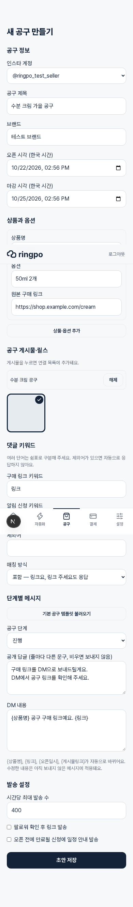
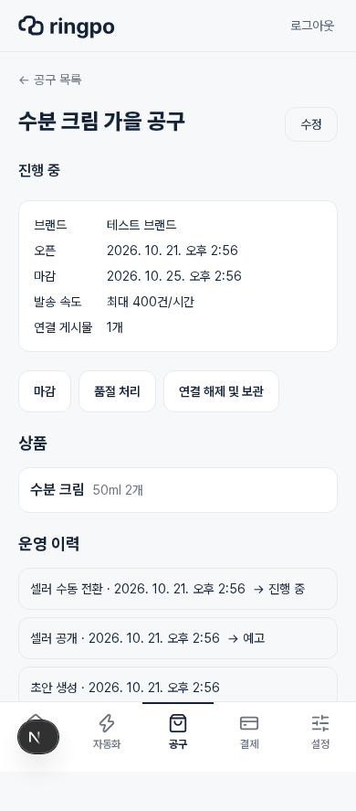
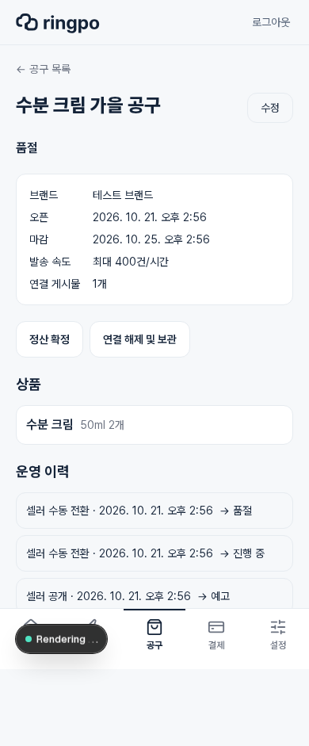

# M1-1 검증 결과

확인일: 2026-10-21 UTC. 범위는 캠페인 CRUD·권한·상태 전환·초기 화면이다. 발송 기능은 다음 PR에서 연결한다.

## 자동 검사

- 기존 243개를 포함한 **41개 파일 / 262개 테스트 통과** (74.75초).
- `pnpm typecheck`, `pnpm lint`, `pnpm build:worker`, `pnpm build` 통과.
- migration 0002의 up→down→up, 기존 user 보존, 캠페인 데이터가 있을 때 down 거부 확인.
- Free의 계정 간 동시 공개 경합, Pro 미디어 중복 연결, 교차 소유권, 상태/시각, 중복 스케줄러, flag OFF/재활성화 확인.

## 250계정 상태 전환

[원본 결과 JSON](m1-1-load.json). 2 vCPU/8GB 공유 호스트에서 전용 PostgreSQL 17-alpine 컨테이너·연결 풀 10개를 사용했다. 각 계정에 공구를 생성·공개한 뒤 동일 오픈 시각에 스케줄러 3개를 중복 실행했다. GraphClient는 fixture이며 외부 Meta 호출은 0건이다.

| 항목 | 결과 |
| --- | ---: |
| 계정 / 공개 공구 | 250 / 250 |
| 생성·공개 준비 | 5,407ms |
| 중복 스케줄러 3개가 250개 오픈 처리 | 2,682ms |
| 누락 / 중복 전환 | 0 / 0 |
| 전환 감사 기록 | 계정당 정확히 1개 |

재현:

```sh
# TEST_DATABASE_URL은 폐기 가능한 전용 DB만 지정한다. 통합 setup이 스키마를 초기화한다.
GONGGU_LOAD_REPORT=/tmp/gonggu-foundation-load.json pnpm test tests/integration/campaign-foundation-load.test.ts
```

이 결과는 **DM 발송 성능 시험이 아니다**. 250계정 × private reply 400/h는 약 27.8 API calls/s이고 공개 답글 120/h를 더하면 약 36.1/s다. 일반 DM·메타데이터 조회·재시도는 추가된다. 기존 concurrency 8/inline sleep을 그대로 둔 상태의 처리량을 보장하지 않으며, due 시각을 DB에 저장하는 dispatch와 독립 HTTP 동시성 시험이 필요하다. 발송 누락·중복·rolling-hour 상한·ETA 오차는 M1-3/M2-1 결과에 기록한다.

## 브라우저·DB 확인

Playwright/Chromium, 390×844 화면, 별도 테스트 DB와 가짜 Meta 미디어 응답으로 확인했다. 서버에서 Meta 쓰기는 차단했다. 실제 Instagram 두 계정 수동 점검은 아직 수행하지 않았다.

| 경계 | 결과 |
| --- | --- |
| 셀러 세션 → 캠페인 목록 | 200, 기능 탭 표시 |
| 생성 폼 → Server Action | 상품·키워드·KST 일정·미디어 입력 후 저장 성공 |
| 소유권 조회 → DB | 미디어 owner를 검증하고 draft/product/media/audit 저장 |
| 예고 → 조기 오픈 → 품절 | 각 action 성공, UI 상태 갱신 |
| 최종 DB 대조 | status=sold_out, version=4, created/published/open/sold_out 감사 4개 |
| 브라우저 예외 / 가로 넘침 | 0 / 없음 |







## 배포 경계

기능 플래그는 기본 OFF다. 이 PR만 활성화하면 상태/설정 화면까지 제공하며 댓글 응답·발송 현황·리포트는 아직 연결되지 않는다. 운영 일반 공개는 후속 구현과 검증 이후에 한다. [운영 절차](../runbook.md)를 참고한다.
